<!--
  README de perfil — aluisiodev
  Os SVGs em ./assets (versões escura e -light) são gerados por gen2.py (rode `python3 scripts/gen2.py` na raiz do repositório depois de editar textos ou cores).
-->

<p align="center">
  <picture><source media="(prefers-color-scheme: light)" srcset="./assets/header-light.svg"></picture>
</p>

<p align="center">
  <picture><source media="(prefers-color-scheme: light)" srcset="./assets/stack-light.svg"></picture>
</p>

<details>
<summary><a><picture><source media="(prefers-color-scheme: light)" srcset="./assets/btn-repos-light.svg"></picture></a></summary>
<br>

<p align="center">
  <a href="https://github.com/aluisiodev/MiraV"><picture><source media="(prefers-color-scheme: light)" srcset="./assets/repo-mirav-light.svg"></picture></a>
  <a href="https://github.com/aluisiodev/doce-e-afeto"><picture><source media="(prefers-color-scheme: light)" srcset="./assets/repo-doce-e-afeto-light.svg"></picture></a>
</p>

</details>

<details>
<summary><a><picture><source media="(prefers-color-scheme: light)" srcset="./assets/btn-conectar-light.svg"></picture></a></summary>
<br>

<p align="center">
  <a href="https://linkedin.com/in/aluisio-alves"><picture><source media="(prefers-color-scheme: light)" srcset="./assets/conectar-light.svg"></picture></a>
</p>

</details>

<details>
<summary><a><picture><source media="(prefers-color-scheme: light)" srcset="./assets/btn-tudo-light.svg"></picture></a></summary>
<br>

```console
$ cat sobre.txt
```

Sou o **Aluísio**, dev full stack. Construo back-ends rápidos com **C#** e **Go**, interfaces com **TypeScript** e coloco tudo de pé com **Docker** e **Kubernetes**. Também estudo segurança ofensiva com **Kali Linux**.

```console
$ ls ./stack --detalhado
```

| módulo  | ferramentas                    |
| ------- | ------------------------------ |
| LANG    | C# · TypeScript · Go           |
| RUNTIME | Node.js                        |
| INFRA   | Docker · Kubernetes            |
| DATA    | Redis                          |
| SECOPS  | Kali Linux                     |

```console
$ ls ./repos --destaque
```

- **[MiraV](https://github.com/aluisiodev/MiraV)** · site de um projeto acadêmico, feito para prospectar potenciais clientes.
- **[Doce & Afeto](https://github.com/aluisiodev/doce-e-afeto)** · SPA para aumentar a prospecção e a divulgação da confeitaria Doce & Afeto.

```console
$ ./conectar
```

**LinkedIn:** [linkedin.com/in/aluisio-alves](https://linkedin.com/in/aluisio-alves)

</details>

<p align="center"><sub><code>// fim da transmissão · conexão mantida por um ciborgue de 84px</code></sub></p>
