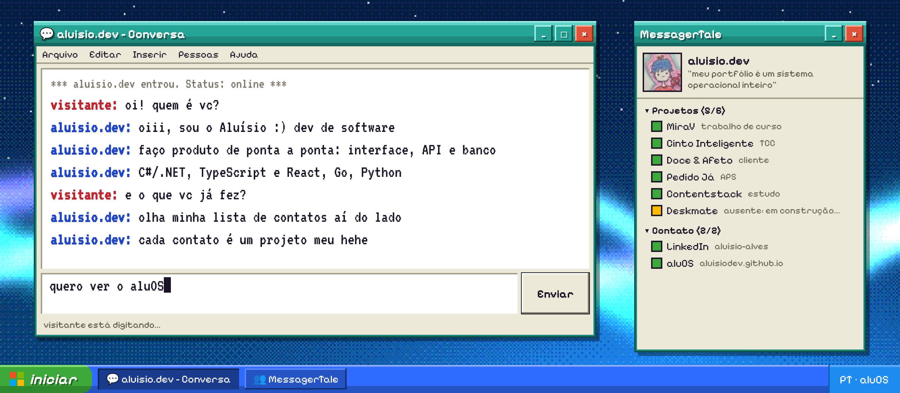
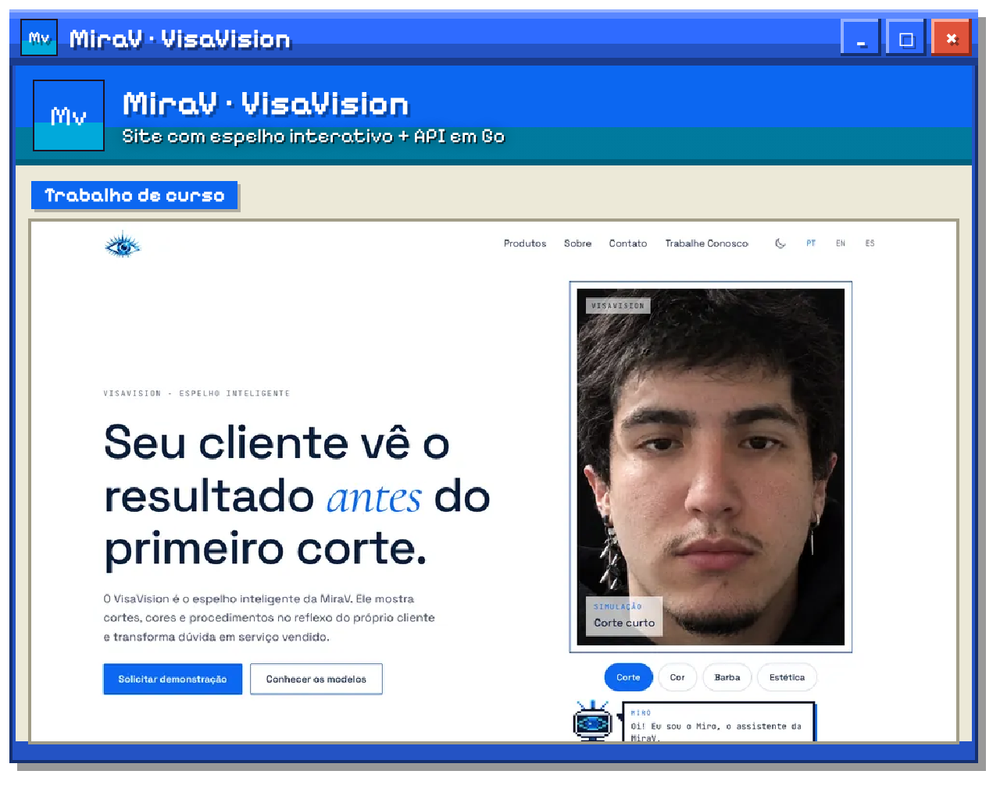
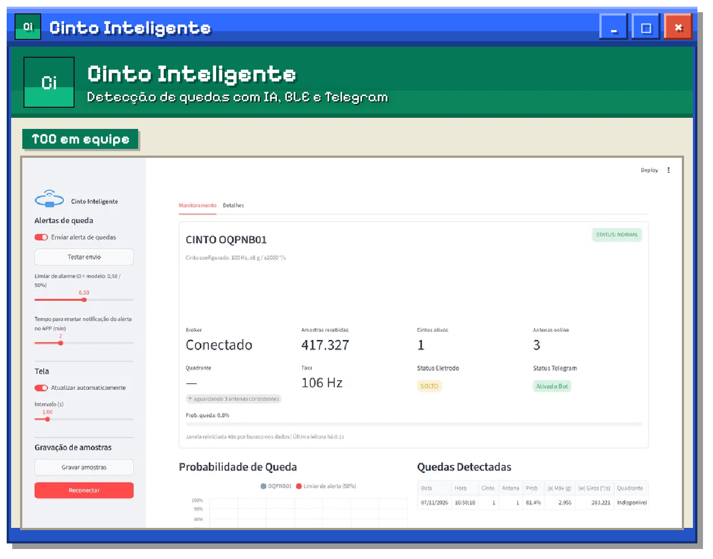
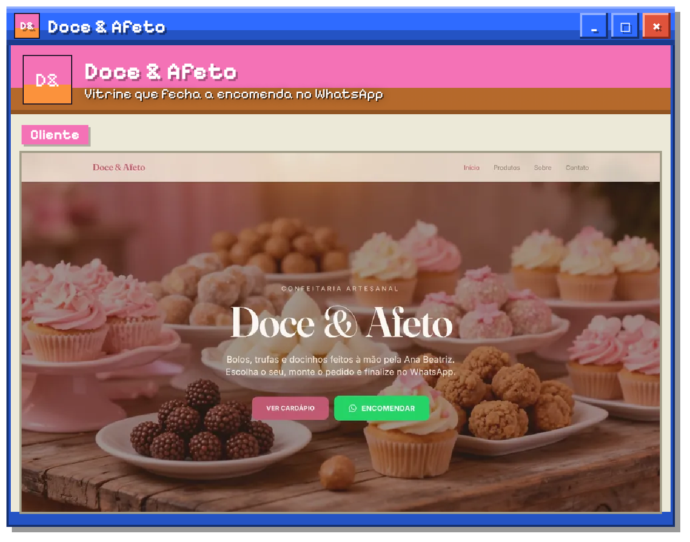
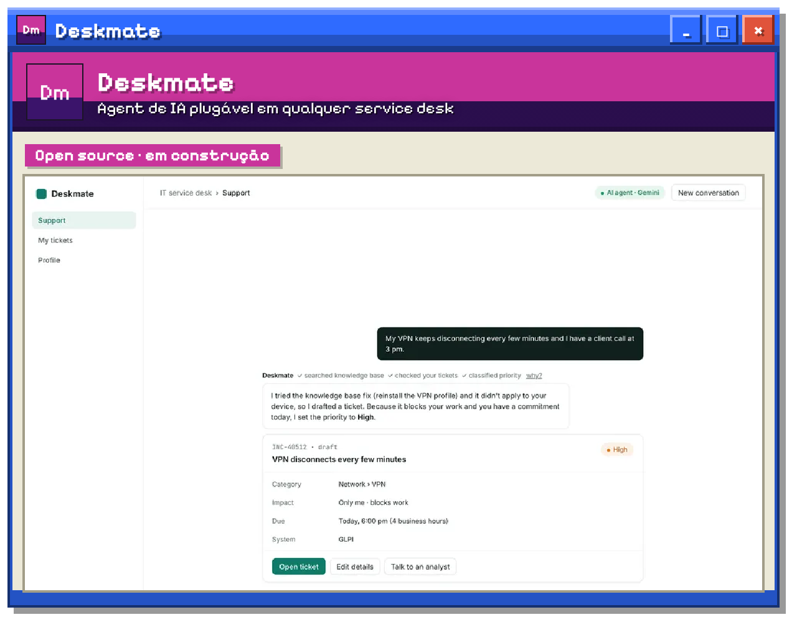
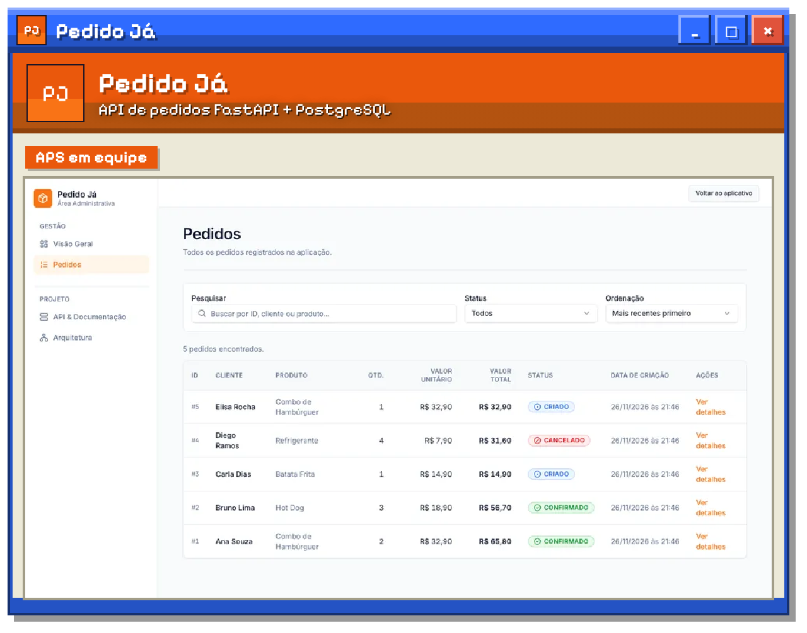

<!-- README de perfil no estilo do aluOS (messenger antigo). As imagens ficam em assets/aluos/. -->

<a href="https://aluisiodev.github.io/"></a>

<p align="center">
  <a href="https://aluisiodev.github.io/"></a>
  <a href="https://www.linkedin.com/in/aluisio-alves/"></a>
</p>

```text
C:\Usuários\Aluísio> dir Projetos

 Pasta de C:\Usuários\Aluísio\Projetos

 26/11/2026  <DIR>   MiraV          trabalho de curso · site + espelho 3D + API em Go
 26/11/2026  <DIR>   Cinto Intel.   TCC em equipe · detecção de quedas com IA
 26/11/2026  <DIR>   Doce & Afeto   cliente · encomenda pronta no WhatsApp
 26/11/2026  <DIR>   Deskmate       projeto pessoal · agent de IA open source
 26/11/2026  <DIR>   Pedido Já      APS em equipe · FastAPI + PostgreSQL
 26/11/2026  <DIR>   Contentstack   estudo · CMS headless com .NET
                6 pasta(s)   ∞ ideias disponíveis
```

## 📁 Projetos

<table>
<tr>
<td width="50%" valign="top">
<a href="https://github.com/aluisiodev/MiraV"></a>
<b>MiraV · VisaVision</b>: site de uma startup de beleza com espelho interativo, o robô Miro e API própria em Go. Eu fui o CTO da equipe.<br>
<a href="https://mirav.aluisioalves6.workers.dev/">site no ar</a> · <a href="https://github.com/aluisiodev/MiraV">código</a>
</td>
<td width="50%" valign="top">
<a href="https://github.com/KaykyCrespo/cinto-inteligente-deteccao-quedas"></a>
<b>Cinto Inteligente</b>: TCC em equipe. Cinto vestível que detecta quedas de idosos com Random Forest (98,8% das quedas detectadas), estima o cômodo por BLE e avisa no Telegram. Fui pesquisador e redator.<br>
<a href="https://github.com/KaykyCrespo/cinto-inteligente-deteccao-quedas">código (repositório da equipe)</a>
</td>
</tr>
<tr>
<td width="50%" valign="top">
<a href="https://github.com/aluisiodev/doce-e-afeto"></a>
<b>Doce & Afeto</b>: vitrine de uma confeitaria (cliente real). A pessoa monta a encomenda e ela chega pronta no WhatsApp.<br>
<a href="https://doce-e-afeto.vercel.app/">site no ar</a> · <a href="https://github.com/aluisiodev/doce-e-afeto">código</a>
</td>
<td width="50%" valign="top">
<a href="https://github.com/aluisiodev/Deskmate"></a>
<b>Deskmate</b>: agent de IA open source que se pluga em qualquer service desk. Ideia, design e código meus. Em construção (imagem de mockup).<br>
<a href="https://github.com/aluisiodev/Deskmate">código</a>
</td>
</tr>
<tr>
<td width="50%" valign="top">
<a href="https://github.com/aluisiodev/pedidos-ja"></a>
<b>Pedido Já</b>: API de pedidos em FastAPI com PostgreSQL, Alembic e Docker, mais a interface em React. APS em equipe.<br>
<a href="https://github.com/aluisiodev/pedidos-ja">código</a>
</td>
<td></td>
</tr>
</table>

Também tem o [**Contentstack Delivery App**](https://github.com/aluisiodev/contentstack-delivery-app), um app ASP.NET Core que renderiza conteúdo de um CMS headless.

## 🧰 Skills

<p>


</p>

```text
*** mensagem automática de aluisio.dev ***
tô online e respondendo! se eu demorar, me chama no LinkedIn
ou abre o aluOS e manda um oi pelo MessagerTale :)
```

<a href="https://aluisiodev.github.io/"></a>
